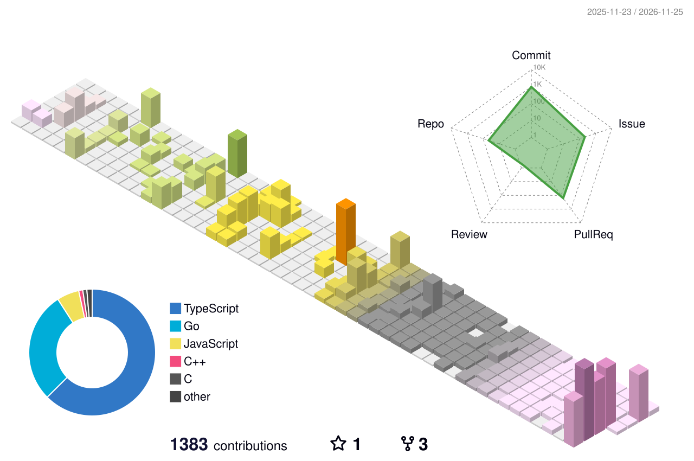

# Cesar Menegatti

**Engenheiro de software backend (Go) na TOTVS Cloud · autor de _Go na Prática_ · ex-engenheiro civil**

Construo ferramentas para desenvolvedores, bibliotecas Go e, nas horas vagas, jogos de terminal.

---

## 🚀 Projeto em destaque: Zeno

<table>
<tr>
<td width="55%">

</td>
<td>

### [Zeno](https://github.com/chmenegatti/zeno)

Cliente de API desktop **sem abas**: uma tela, coleções em YAML versionáveis no git e segredos criptografados com a chave no chaveiro do sistema.

- 📁 Cada request é um arquivo YAML
- 🔐 Cofre de segredos local
- 📥 Importa coleções do Insomnia
- 🖥️ Linux · Windows · macOS, sem conta nem telemetria
- ⚙️ Go + Wails

**[Baixar](https://github.com/chmenegatti/zeno/releases/latest)** · **[Site](https://www.cesarmenegatti.com/zeno/)**

</td>
</tr>
</table>

---

## 🛠️ Projetos

| Projeto | O que é | Stack |
|---|---|---|
| 🚗 [**Oiapoque–Chuí**](https://github.com/chmenegatti/oiapoque-chui) | Um Fiat 147 atravessando o Brasil em pixel art, no terminal. Dá pra jogar por SSH. · [site](https://www.cesarmenegatti.com/oiapoque-chui/) | Go · tcell · wish |
| 📅 [**go-date-fns**](https://github.com/chmenegatti/go-date-fns) | Utilitários de data inspirados no date-fns, com fuso horário e suporte a WebAssembly | Go |
| 🔁 [**goretry**](https://github.com/chmenegatti/goretry) | Retry com generics, `context.Context`, backoff exponencial e full jitter | Go |
| ⚡ [**gocachex**](https://github.com/chmenegatti/gocachex) | Abstração de cache distribuído com vários backends | Go |
| 📝 [**lazylog**](https://github.com/chmenegatti/lazylog) | Logging extensível inspirado no Winston | Go |

---

## 📚 Escrita

- **[Go na Prática](https://www.cesarmenegatti.com/go-na-pratica/)**: livro de Go para quem quer escrever código de produção (impresso e Kindle).
- **Por baixo do capô**: série no [LinkedIn](https://linkedin.com/in/cesarmenegatti) sobre como as coisas funcionam por dentro (encoding, runtime, rede).

<!-- BLOG-POST-LIST:START -->
<!-- BLOG-POST-LIST:END -->

---

## 🧰 No dia a dia

Gateway de orquestração na TOTVS Cloud, com integrações VMware NSX-T/vSphere, Palo Alto, Fortinet, NetApp e Rubrik.

---

  

